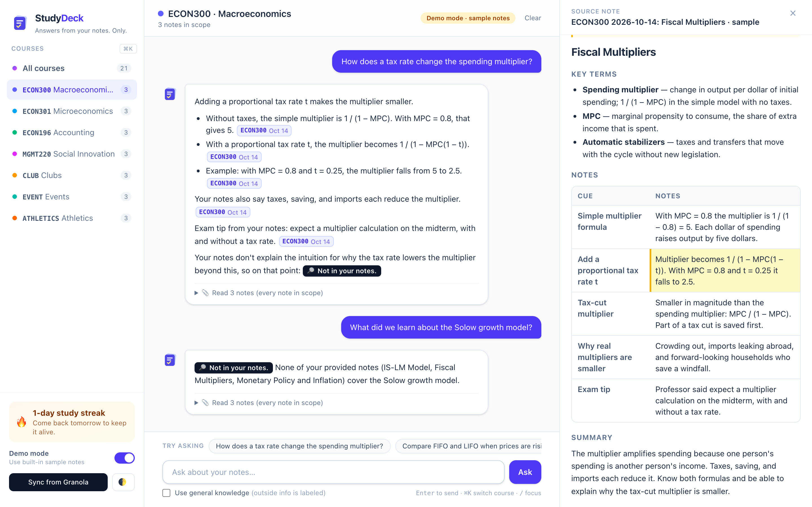
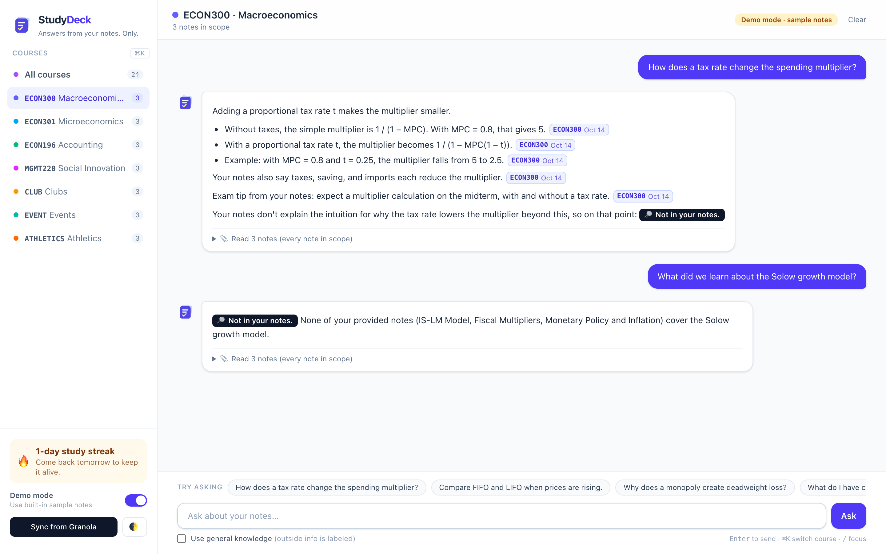
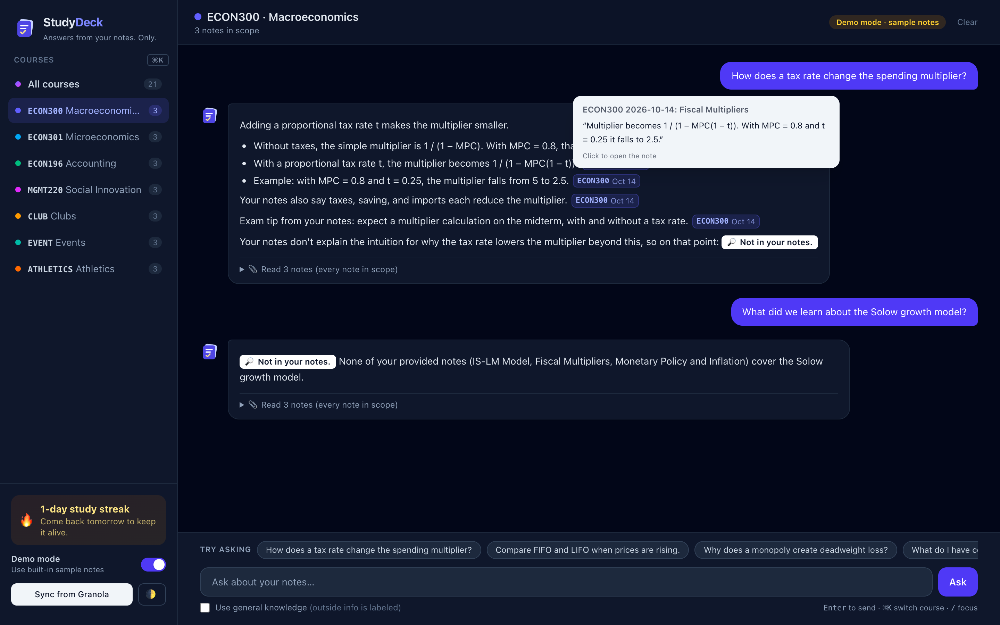
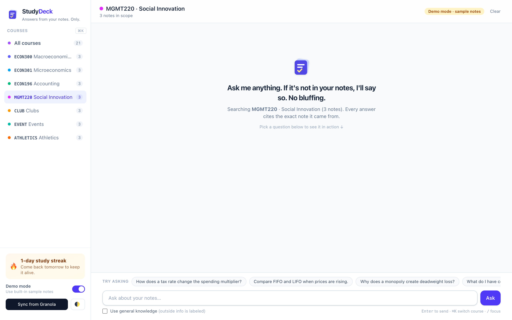
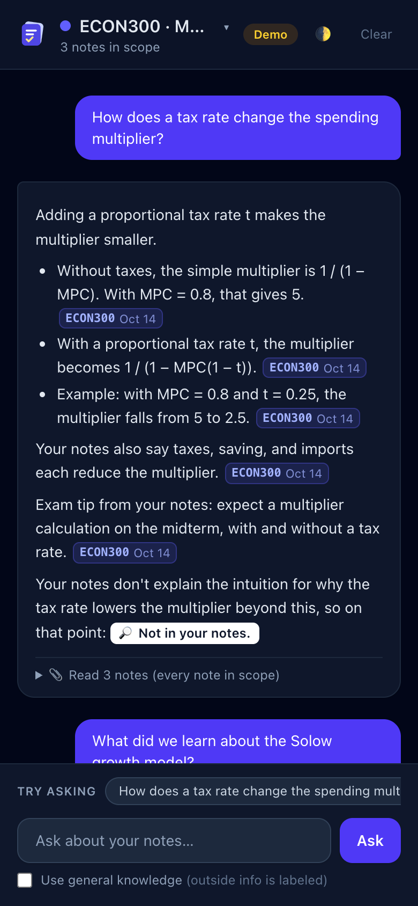
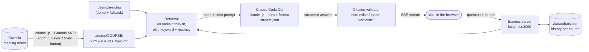

<p align="center">
  
</p>

<h1 align="center">StudyDeck</h1>

<p align="center"><b>A NotebookLM for your own semester: ask questions about your class notes and get answers that only come from your notes, with a receipt for every claim.</b></p>

<p align="center">
  
</p>

<p align="center"><i>Every claim links to the note it came from. Click a citation and the source opens, scrolled to the exact passage.</i></p>

---

## Why I built it

I'm a junior at Hobart and William Smith studying Economics with an Entrepreneurship minor. This semester my notes are spread across four classes (Macro, Micro, Accounting, Social Innovation) plus clubs, events and athletics. I take them all in [Granola](https://granola.ai), which is great for capturing a lecture and bad at answering "wait, what did the professor say about the tax-cut multiplier?" three weeks later.

I tried AI study tools, and two things kept bugging me:

1. **Uploading.** Every tool wanted me to export, upload and organize files. My notes already exist; I wanted a tool that already knows my semester.
2. **Confident guessing.** When my notes didn't cover something, chatbots filled the gap with general knowledge that sounded like my professor but wasn't. Before an exam, I need to know what *was* covered.

StudyDeck fixes both. It syncs my Granola notes into course folders automatically, and it answers **only** from those notes. Every claim carries a citation, and **"Not in your notes"** is a perfectly good answer.

## Features

- 📚 **Course-aware chat.** Pick a course (or All courses) in the sidebar and the chat only reads that course's notes.
- 🧾 **Cited, verified answers.** Every claim is cited as `[ECON300 2026-10-14: Fiscal Multipliers | "quote"]`. The server checks that each cited note was actually provided and that the quote appears word-for-word; anything that fails shows up as a red ⚠ chip.
- 🔎 **"Not in your notes" is first-class.** The model is told not to fill gaps. Outside knowledge is opt-in with a clearly labeled toggle, and every outside sentence is tagged 🌐 General knowledge.
- 👀 **Click or hover any citation.** Hover for a preview of the exact passage; click to open the note scrolled to it, highlighted.
- 🔄 **One-click Granola sync.** Pulls the last 14 days of meetings, routes each to the right course (by title prefix, or Claude's best guess from the content), skips duplicates, and moves previously unsorted notes once it knows where they go.
- ⚡ **Streaming answers** with a live typing cursor.
- 🎬 **Demo mode** with 21 built-in sample notes, so a demo never depends on live sync or your private notes.
- ⌨️ **Keyboard first:** `Enter` to send, `⌘K` to switch course, `/` to focus, `Esc` to close.
- 🌙 **Dark mode**, 📱 **phone layout**, and a 🔥 **study streak** to keep you coming back.
- 🔒 **Local and private.** Notes are markdown files on your machine. No database, no API keys, no cloud storage.

| Not in your notes (honesty by default) | Hover preview, dark mode |
|---|---|
|  |  |

| Empty state with "Try asking" | Phone |
|---|---|
|  |  |

## How it works



1. **Sync.** `claude -p` runs with only Granola's `list_meetings` and `get_meetings` tools allowed. It returns JSON; my code (not the model) decides file names, dedupes by Granola meeting id, and writes markdown into `./notes/<course>/`.
2. **Retrieve.** If a course's notes fit comfortably in context (about 200k characters) they're all sent. Otherwise notes are ranked by keyword overlap plus a recency boost. The UI always says which notes were read.
3. **Answer.** The server spawns `claude -p` in a locked-down mode: no tools, no MCP servers, no user settings or `CLAUDE.md`, no saved session. That keeps each call to about 2.5k tokens of overhead instead of about 60k. Notes are wrapped in `<note>` tags and marked as data, not instructions.
4. **Verify.** Every citation is parsed and checked against the notes that were sent. The answer streams to the browser over Server-Sent Events.

**Stack:** Node + TypeScript + Express on the server; plain HTML/JS + Tailwind CSS v4 in the browser; Vitest for tests. No framework, no database, no API key.

## StudyDeck vs. NotebookLM

NotebookLM is a great product, and it also cites its sources. StudyDeck is narrower on purpose: it's built for one student's semester.

| | StudyDeck | NotebookLM |
|---|---|---|
| Getting notes in | **Auto-syncs from Granola**, routed by course | Upload or link sources per notebook |
| Knows your semester structure | **Yes**: courses, clubs, events, with a scope switch | You organize notebooks yourself |
| Answers grounded in your sources with citations | Yes | Yes |
| Each citation re-checked word-for-word after answering | **Yes**, failures flagged with ⚠ | Citations link to source passages |
| "Not in your notes" as an explicit answer | **Yes, a labeled badge, by default** | Usually says the sources don't cover it |
| Outside knowledge | **Off by default**; opt-in and labeled sentence by sentence | Mostly limited to sources |
| Where your notes live | **Plain files on your laptop** | Google's cloud |
| Flashcards, quizzes, study guides | Roadmap (Exam mode) | **Yes** |
| Audio overviews, PDFs, YouTube, slides as sources | No | **Yes** |
| Setup | Node + Claude Code CLI | **None, just a browser** |

## Quick start

You need **Node 20+** and **[Claude Code](https://claude.com/claude-code)** installed and logged in (run `claude` once). No API key is required; StudyDeck uses your existing Claude login.

```bash
# 1. Get the code
git clone https://github.com/seankessner05/studydeck.git && cd studydeck

# 2. Install
npm install

# 3. Run, then open http://localhost:3000
npm start

# 4. (Optional) Connect Granola, then click "Sync from Granola" or run: npm run sync
claude mcp list   # look for a connected Granola server
```

If Granola isn't listed, add it and log in:

```bash
claude mcp add --transport http granola https://mcp.granola.ai/mcp
```

Then run `/mcp` inside Claude Code to authenticate.

Until you sync, StudyDeck uses the 21 sample notes in `./sample-notes`. Flip **Demo mode** in the sidebar to use the samples even after you have real notes.

**Scripts:** `npm start` (build CSS + run), `npm run dev` (auto-reload), `npm run sync`, `npm test`, `npm run typecheck`. Set `PORT` to change the port.

### Note format

Notes are markdown with a small frontmatter header. Synced notes look like this:

```markdown
---
title: Fiscal Multipliers
course: ECON300
date: 2026-10-14
source: granola
granola_id: abc123
---
...your notes...
```

Name meetings in Granola with a course prefix (`ECON300 Fiscal policy`) for perfect routing; otherwise Claude guesses from the content, and anything uncertain goes to `./notes/unsorted`.

## Privacy

- `./notes` (your real notes), `./data` (chat history and settings) and `.env*` are git-ignored. Only the fictional sample notes are in this repo.
- Notes are sent to Claude through your own Claude Code login, the same as if you pasted them into Claude yourself. Nothing else leaves your machine.
- The server listens on `127.0.0.1` only.

## Roadmap

**What makes it better than NotebookLM, next:**

- 🃏 **Exam mode.** Flashcards, practice quizzes and a one-page cheat sheet per course, all cited back to your notes.
- 🎯 **Weak-spot tracking.** Remember which concepts you miss on quizzes and prioritize them.
- 🧭 **Gap check.** Compare a course's notes against the syllabus and flag topics you may have missed.
- 🗂 **Move notes in the app.** Fix a mis-routed note with one click.
- 🧠 **Semantic retrieval** (local embeddings) for very large semesters.
- 📄 **More sources:** PDFs and slide decks alongside Granola notes.

## Limitations (honestly)

- **Needs Claude Code.** Every question runs the `claude` CLI on your machine and counts against your Claude plan. Answers take about 3 to 15 seconds.
- **Keyword retrieval.** When a course outgrows the context budget, ranking is keyword + recency, not semantic, so a question phrased very differently from the notes can miss.
- **Citation checks have limits.** They catch invented notes and invented quotes, but not a real quote attached to a claim it doesn't fully support.
- **Sync relies on the model to copy notes verbatim.** It's instructed not to rewrite, but it's still an LLM in the loop. Course guessing for unprefixed titles can be wrong; in my first real sync, one of 11 notes (a "monopoly project" meeting) went to Accounting when I would have expected Microeconomics. There's no in-app way to move a note yet (move the file by hand).
- **Short memory.** Follow-up questions see only the last 6 messages of that course's chat.
- **Single user, single machine.** Tested on macOS with Chrome; not tested on Windows.

## Development

```bash
npm test          # 34 tests: note loading, retrieval, citation parsing, prompt, sync, API
npm run typecheck
```

Tests never call the real CLI: the Claude runner is injected, so the API and sync are tested with fakes.

## License

[MIT](LICENSE) © 2026 Sean Kessner
